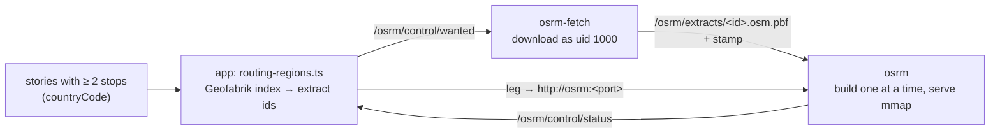

# Bundled street routing whose regions follow the stories

- **Status:** implemented; owner approves spec and code together at merge.
- **Risk:** **High** (`CLAUDE.md`): changes the routing allow-list grammar (the `safeFetch`
  exemption), adds an app-initiated outbound fetch (the Geofabrik index), makes authored content
  choose which extracts are downloaded, and replaces the compose topology of v0.19.0.
- **Supersedes in part:** `2026-11-03-osrm-compose-routing-design.md` (decisions 2 and 3 and its
  topology). Its private-network invariants, misuse cases and snap bound still apply.

## Owner decision (2026-11-04)

The owner does not want to edit `.env` when a story in a new country is added. Of three options
(per-country automatic, merged automatic, public OSRM service) the owner chose **per-country,
automatic**: one dataset per country, built and served without operator input.

| Option | Why not chosen |
|---|---|
| Merged automatic | Build memory grows with every country; the eight story countries (≈ 3.5 GB of extracts) are not expected to fit a 32 GB host (extrapolated). Every new country rebuilds all. |
| Public service | Stop coordinates, including drafts, leave the server, under a third party's usage policy. |

Accepted trade-off: a leg **between** two countries is a flagged straight line (separate graphs).

## Flow

1. **Countries.** `PostStore.routingCountries()` returns the distinct `countryCode` of stories (any
   status) with two or more stops, never the import placeholder `XX`.
2. **Extracts.** The Geofabrik index `index-v1-nogeom.json` (≈ 0.5 MB) is fetched through `safeFetch`
   (4 MiB cap, 20 s, no redirects), cached 24 h, retried after 10 minutes on failure; an unreachable
   index never drops known regions. Each ISO 3166-1 code maps to exactly one extract; a code listed
   by several extracts (VU, MH in the 2026-11-04 index) is **unsupported**, never guessed; a combined
   extract (IL/PS → `israel-and-palestine`) serves each of its codes. Only ids `[a-z0-9-]` and
   `https://download.geofabrik.de/…-latest.osm.pbf` URLs are accepted.
3. **Wanted.** The app writes `/osrm/control/wanted` (`<id> <url>` per line, sorted) atomically and
   only when it changed: at boot, every 5 minutes, after each story save, and when a story's routing
   panel is opened or calculated.
4. **Download.** `osrm-fetch` (long-running) re-validates each line in shell, installs `curl` from
   Debian only when a download is due, downloads as uid 1000 to a `.part` file, renames, and writes
   a per-download stamp. A failed download is retried after an hour.
5. **Build and serve.** `osrm` (long-running, uid 1000, no capabilities) gives each extract a stable
   slot (`/osrm/data/<id>/slot`) and builds car → bike → foot **one build at a time** in
   `<mode>.tmp`, swapping in on success, so a failed build keeps the previous graph. Each graph is
   served by `osrm-routed --mmap=1` on `5100 + 3 × slot + {0, 1, 2}` (≤ 300 extracts, ports ≤ 5999).
   A failed build is retried after a refresh (new stamp) or a restart. Extracts no longer wanted stop
   serving; their files stay for a fast re-add.
6. **Status.** `osrm` writes `/osrm/control/status` (`<id> <state> <car> <bike> <foot>`;
   `downloading` / `building` / `ready` / `failed`, port or `-`). The app drops any malformed line
   whole and accepts only ports 5100–5999.
7. **Routing.** Per leg the router uses the story country's ready bundled server, otherwise the
   Settings URL (now optional external services). `GET`/`POST /posts/:tk/stop-route` add
   `bundled: {state, region}` (never a URL or port); the editor names the state and re-checks every
   30 s while preparing.

## Allow-list

`ROUTING_INTERNAL_ORIGINS` gains one entry form: **one host with an inclusive port range**
(`http://osrm:5100-5999`). Exact origins keep working. Rejected at boot: inverted, zero or
> 65535 ranges, wildcards, paths, queries, fragments, credentials. `ROUTING_BUNDLED_DIR` and
`ROUTING_BUNDLED_HOST` (compose literals `/osrm`, `osrm`) must be set together, and both ends of the
port range on that host must be listed, or boot is refused.

## Misuse cases

- **Author picks a country to make the server download.** Possible by design, from one fixed host
  and Geofabrik's country list only; cost is disk and build time, each build bounded by
  `OSRM_MEM_LIMIT`. Authors are already trusted to publish content.
- **Hostile or broken index.** Only Geofabrik-host URLs with the expected suffix and id grammar
  survive parsing in the app and again in `osrm-fetch`; ambiguous codes are dropped.
- **Tampered status file.** Ports outside 5100–5999, unknown states and malformed ids are discarded;
  the router additionally requires the allow-list to cover the endpoint.
- **Something else on host `osrm` in the range.** Only the `osrm` service runs there; the range is
  a compose literal.

## Verification

- Vitest:
  - `routing-origins.test.ts`: port ranges, inclusive bounds, other host/scheme/port refused,
    malformed ranges refuse boot.
  - `routing-regions.test.ts`: index resolution (ambiguous, foreign host, bad id, combined
    extract), wanted body, status parsing, sync writes only on change, cached index on outage,
    retry backoff, per-country state and ready-only endpoints.
  - `stop-routing.test.ts`: bundled server per leg, Settings fallback, unlisted bundled origin
    never used.
  - `stop-route-api.test.ts`: `bundled` state and per-story profiles, sync triggered, no URL
    leaked, no field without bundled routing.
  - `posts.test.ts` and `stop-route-persistence.integration.test.ts`: `routingCountries` on the
    memory store and on Postgres.
  - `editor-dom.test.ts`: preparing, failed and unsupported messages; none once ready.
- Smoke (arm64, 2026-11-04, disposable stack from this branch):
  - A Costa Rica story with two stops → the app wrote `costa-rica` to wanted, `osrm-fetch`
    downloaded it, `osrm` built and served car/bike/foot within **80 s**, and car, bike and foot
    routes were road legs.
  - Saving an Ecuador story added `ecuador`, ready in 192 s.
  - A leg from Costa Rica to Quito → straight `no_route`.
  - Restarting `osrm` re-served both countries without rebuilding.
  - Clearing Ecuador's stops stopped its servers within 15 s.
  - Build peaks: Costa Rica 0.9 GB (car).

## Rollback and containment

- Containment: stop `osrm-fetch` and `osrm`, or remove `ROUTING_BUNDLED_*` and
  `ROUTING_INTERNAL_ORIGINS` from compose; routing then uses only the Settings URLs.
- Revert: revert the PR and restore v0.19.0's compose file with an `OSRM_PBF_URLS` list. The `osrm`
  volume is rebuildable map data; remove it only with owner authorization (Golden Rule 3).
